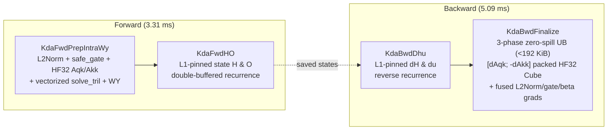

# ascend-kda-catlass

**Source-JIT Native-TND AscendC + CATLASS KDA (Kimi Delta Attention) forward & backward kernels for Huawei Ascend 910C (Atlas A2 / `dav-2201`).**

- **Fully source-inspectable JIT** (cache-keyed by source SHA-256 + CANN version + NPU arch + PyTorch/torch_npu versions — no opaque prebuilt binary wheel).
- **Native `[T, H, 128]` TND packed varlen layout** end-to-end with zero `TND <-> NTD` transposes.
- **4 fused `MIX_AIC_1_2` kernels** covering Q/K FP32 L2Norm, `safe_gate` (`lower_bound * sigmoid(exp(a_log) * (g + dt_bias))`), `beta` sigmoid, intra-chunk `solve_tril` + WY transform, chunk state recurrence, and full backward.
- **40/40 numerical parity** against exact FP32 recurrent gold (including ragged tails `L=1, 13`, odd task counts, extreme decay, and strongly collinear keys `cos_sim >= 0.995`).

---

## Verified Benchmarks on Ascend 910C (Atlas A2)

### 1. Single-Card Interleaved `A1 -> B -> A2` (`T=16384, H=16, D=128`, 8 packed sequences of 2048, BF16)

| Implementation | Fwd (ms) | Bwd (ms) | Total Wall (ms) | Kernel Busy (ms) | Speedup |
| :--- | ---: | ---: | ---: | ---: | ---: |
| `fla_npu` (`fla_npu_transformer`, ext L2Norm workaround\*) | 4.60 | 6.53 | 10.376 | 10.090 | 1.00× |
| `fla_npu` (adjusted, subtracting `0.501 ms` workaround tax\*) | ~4.10 | 6.53 | ~9.875 | ~9.589 | ~1.05× |
| **`ascend-kda-catlass` (ours)** | **3.308** | **5.091** | **8.237** | **8.138** | **1.260×** (`1.20×` adj.) |

*\*Transparency note on `fla_npu` breakdown (Level-1 `PipeUtilization` trace)*:
- `1.496 ms` (`5× TransposeV2` = `0.538 ms` + `6× Cast` = `0.958 ms`) comes natively from inside `fla_npu`'s backward `aclnn` execution.
- `0.501 ms` (`2× l2norm_fwd_kernel` = `0.242 ms` + `4× Transpose` = `0.259 ms`) comes from computing L2Norm externally to work around a collinear-key overflow bug (`akk_max = 1.907e+04`, `out_max = 2.158e+11` when `use_qk_l2norm_in_kernel=True` on `cos_sim >= 0.995`). Even subtracting that `0.501 ms` completely, `ascend-kda-catlass` remains **`1.20×`** faster.

### 2. Per-Kernel Level-1 Hardware Profile (`T=16384, H=16, D=128`)

| Kernel (`MIX_AIC_1_2`) | Time (ms) | `aic_mac` | `aic_mte2` | `aiv_vec` | `aiv_mte2` |
| :--- | ---: | ---: | ---: | ---: | ---: |
| `KdaFwdPrepIntraWy` | 2.096 | 0.072 | 0.381 | 0.500 | 0.193 |
| `KdaFwdHO` | 1.098 | 0.106 | 0.332 | 0.139 | 0.249 |
| `KdaBwdDhu` | 1.229 | 0.113 | 0.502 | 0.288 | 0.268 |
| `KdaBwdFinalize` | 3.655 | 0.107 | 0.496 | 0.466 | 0.326 |
| `ReduceSum` (`2×`) + `ZerosLike` (`2×`) | 0.060 | — | — | — | — |
| **Total AI Core Busy** | **8.138** | | | | |

### 3. End-to-End 8× Ascend 910C Production Training (Paired ABBA)

On an 8-card MoE-LLM pretraining workload (`d=1024, T=16384, H=16, D=128`, packed varlen, varying only KDA backend `a1/b1/b2/a2`):
- Step time: `5.4195 s` → **`4.9740 s`** (**`-445.5 ms/step`**, **`1.0896×`**, **`+1.194 pp` MFU**)
- 4-step training loss parity: `|Δloss| = 4.8e-6 .. 5.8e-5` (within baseline run-to-run variance)

---

## Architecture & Key Microarchitecture Techniques



1. **Native-TND Strided DMA**: Reads/writes `[T, H, 128]` directly with stride `H * 128`, eliminating all `TND <-> NTD` transposes.
2. **Atlas A2 Native HF32 Cube (`float`) for `da_log` / `ddt_bias` Precision**: In chunked KDA backward, exact `dg_intra` satisfies $\sum_t dg_{\text{intra}}[t] = 0$. BF16 rounding mismatch between `+C_{ij}` and `-C_{ij}` breaks this cancellation, gets integrated by `rev_cumsum` over 64 rows, and sums coherently across `T = 16,384` tokens (`~4.5%` rel-L2 error). Using native Atlas A2 HF32 Cube + exact `AscendC::Div` (avoiding 910C's ~14-bit approximate `Reciprocal`) cuts `da_log` / `ddt_bias` rel-L2 to **`0.15%–0.40%`**.
3. **Vertical `[dAqk; -dAkk]` Packing (`16×128 -> 32×128`)**: Avoids CATLASS `TileMmad`'s hidden `PipeBarrier<PIPE_M>()` when `(m / 16) * (n / 16) < 10`, halving Cube launch overhead in `KdaBwdFinalize`.
4. **Zero-Spill 3-Phase UB Pipelining (`< 192 KiB`)**: Keeps active working sets strictly inside Atlas A2's 192 KiB Unified Buffer with explicit `PIPE_MTE3` writes (safe under `-mllvm -cce-aicore-dcci-insert-for-scalar=false`).
5. **Verified Dead-End**: Lowering off-diagonal Phase 4 to FP16 (`half`) slowed `KdaBwdFinalize` by `+0.196 ms` because it added `+94K` AIV `Cast` ops on an AIV-bound `MIX_AIC_1_2` kernel.

---

## Quick Start

### Prerequisites
- Huawei Ascend 910B / 910C (Atlas A2, `dav-2201`)
- CANN Toolkit (`source /usr/local/Ascend/ascend-toolkit/set_env.sh`)
- PyTorch + `torch_npu`
- [CATLASS](https://gitcode.com/cann/catlass) headers (`export CATLASS_ROOT=/path/to/catlass` or clone into `third_party/catlass`)

### Usage (Automatic Source-JIT)

```python
import torch
import torch_npu
from ascend_kda import chunk_kda_tnd

T, H, D = 2048, 16, 128
cu_seqlens = (0, 512, 1280, 2048)

q = torch.randn(T, H, D, device="npu", dtype=torch.bfloat16, requires_grad=True)
k = torch.randn(T, H, D, device="npu", dtype=torch.bfloat16, requires_grad=True)
v = torch.randn(T, H, D, device="npu", dtype=torch.bfloat16, requires_grad=True)
g = torch.randn(T, H, D, device="npu", dtype=torch.bfloat16, requires_grad=True)
beta = torch.randn(T, H, device="npu", dtype=torch.float32, requires_grad=True)
a_log = torch.randn(H, device="npu", dtype=torch.float32, requires_grad=True)
dt_bias = torch.randn(H, D, device="npu", dtype=torch.float32, requires_grad=True)

out = chunk_kda_tnd(q, k, v, g, beta, a_log, dt_bias, cu_seqlens)
out.sum().backward()
```

### Run 40/40 Parity Suite & Benchmark

```bash
python tests/test_kda_parity.py --device 0
python benchmarks/judge_kda.py --device 0 --profile
```

### Supported Scope & Current Limitations
- Fixed geometry: `head_dim = 128`, `chunk_size = 64`, `BF16` inputs, `TND` packed varlen (`cu_seqlens`), `initial_state = None`, `safe_gate = True`, fused L2Norm & beta sigmoid.
- Hardware target: Atlas A2 (`dav-2201`, 24 AIC / 48 AIV).

---

## License

MIT License. See [LICENSE](LICENSE).
